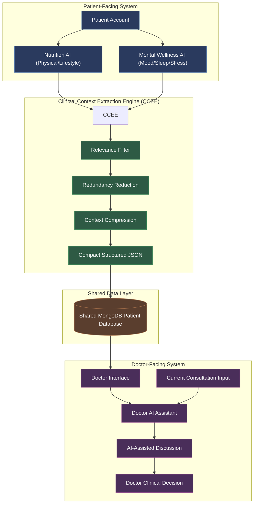

# PCIF Architecture Overview

The **Patient Context Intelligence Framework (PCIF)** is designed to capture, compress, and present longitudinal patient context to support clinician decision-making.

---

## High-Level Data Flow

---

## Component Boundaries

### 1. Patient Interface (`frontend/` & `backend/app/api/`)
- Dual conversational AI interfaces: **Nutrition AI** and **Mental Wellness AI**.
- Both interfaces interact with the patient under the **same unified patient profile**.

### 2. Clinical Context Extraction Engine (`ccee/`)
- Receives conversational transcripts from patient AI sessions.
- Applies relevance filtering, deduplication, and compression.
- Formats structured clinical items for database persistence.

### 3. Data Layer (`database/`)
- Single shared database repository (MongoDB).
- Preserves explicit source lineage (`nutrition`, `mental_wellness`, `doctor`).
- Supports longitudinal history querying by patient ID.

### 4. Doctor System (`backend/app/api/doctor.py` & Doctor Dashboard)
- Enables searching patient records, retrieving longitudinal context timelines.
- Integrates clinician-entered consultation notes with patient-reported context.
- Doctor AI serves purely as contextual decision support (human-in-the-loop).
