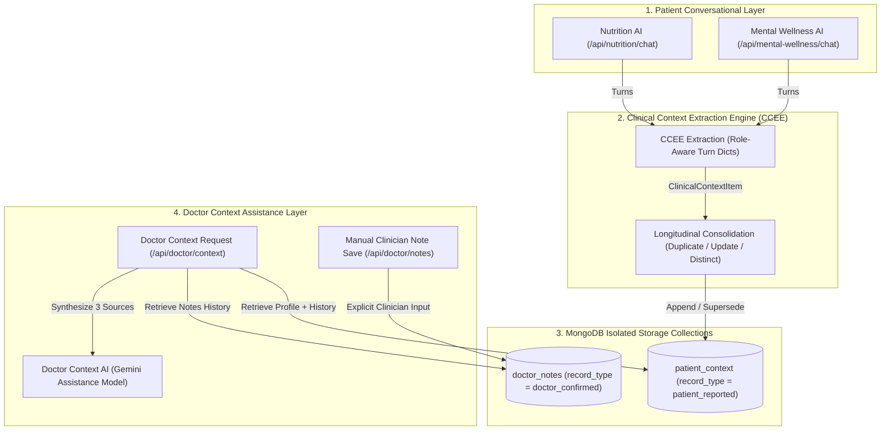

# PCIF End-to-End System Integration & Hardening (`Day 16`)

This document details the complete end-to-end integration architecture, lifecycle flows, storage boundaries, and verification results across the **Patient Context Intelligence Framework (PCIF)**.

---

## 1. Complete PCIF System Flow

The integrated PCIF lifecycle connects patient-facing wellness interactions to clinician-facing contextual assistance while maintaining strict provenance guarantees at every layer:

---

## 2. Three Provenance Channels & Trust Architecture

PCIF enforces strict segregation between three distinct information streams:

| Provenance Channel | Source / Storage | Internal `record_type` | UI Presentation | Trust & Clinical Boundary |
| :--- | :--- | :--- | :--- | :--- |
| **SOURCE A: Current Consultation** | Transient text in clinician workspace | In-memory only (unpersisted) | *"Current Consultation"* | Unconfirmed clinician working notes; never auto-persisted. |
| **SOURCE B: Patient-Reported Context** | Extracted from patient chat into `patient_context` | `patient_reported` | *"Patient-Reported Context"* | Self-reported lifestyle/wellness observations; not clinically confirmed. |
| **SOURCE C: Clinician-Authored Notes** | Explicitly saved in clinician workspace into `doctor_notes` | `doctor_confirmed` | *"Clinician-Authored Notes"* | Notes manually entered by the workspace user. Prototype does not verify clinician identity. |

> [!IMPORTANT]
> **Core Trust Boundary**:
> 1. Patient-reported context is **never** silently converted to clinician-confirmed records.
> 2. AI-generated assistance outputs are **never** automatically written into `doctor_notes` or `patient_context`.
> 3. Discrepancies between sources (e.g. sleep duration conflicts) are **neutrally surfaced** under `items_to_verify` for clinician evaluation without automated resolution.

---

## 3. Storage Separation Invariants

1. **`patient_context` Collection**:
   - Contains only validated, compact `ClinicalContextItem` documents.
   - Strictly forbidden from containing raw conversational text, full messages, or prompt keys.
   - Updated via longitudinal consolidation (`is_current`, `superseded_at`, `superseded_by`).
2. **`doctor_notes` Collection**:
   - Contains only explicitly authored clinician notes (`note`, `patient_id`, `created_at`, `record_type="doctor_confirmed"`).
   - Append-only; does not pass through CCEE or longitudinal deduplication.
3. **Zero Writeback Guarantee**:
   - Calling `POST /api/doctor/context` executes AI reasoning in-memory and returns structured JSON with zero database mutations.

---

## 4. End-to-End Verified Scenarios (Day 16 Test Suite)

All 19 integration scenarios were verified against live MongoDB and simulated failure boundaries:

| ID | Scenario | Verification Focus | Result |
| :--- | :--- | :--- | :--- |
| **E2E-01** | Full PCIF Lifecycle | Nutrition + Mental Wellness $\rightarrow$ CCEE $\rightarrow$ DB $\rightarrow$ Doctor AI $\rightarrow$ Note Save $\rightarrow$ Subsequent Doctor AI | **PASSED** |
| **E2E-02** | Privacy & Anti-Raw Chat Audit | Verifies 0 forbidden chat keys (`messages`, `conversation`, `raw_chat`, etc.) in DB | **PASSED** |
| **E2E-03** | Shared Patient ID Integration | Nutrition and Mental Wellness records coexist under identical `patient_id` with distinct sources | **PASSED** |
| **E2E-04** | Longitudinal Update Flow | E.g. Sleep report (5h $\rightarrow$ 7h) supersedes older record while preserving history | **PASSED** |
| **E2E-05** | Distinct Context Coexistence | Different clinical context categories remain independently active | **PASSED** |
| **E2E-06** | First Doctor Context Call | Patient with 0 clinician notes returns `relevant_clinician_notes = []` without error | **PASSED** |
| **E2E-07** | Non-Diagnostic Safeguards | Response contains zero forbidden fields (`diagnosis`, `treatment_plan`, `risk_score`, etc.) | **PASSED** |
| **E2E-08** | Clinician Note Save & Isolation | Writing to `doctor_notes` leaves `patient_context` document count unchanged | **PASSED** |
| **E2E-09** | Human Authoring & No Writeback | Doctor Context AI execution causes zero database writes | **PASSED** |
| **E2E-10** | Multi-Patient Isolation | Patient A and Patient B data never cross-contaminate prompts, context, or notes | **PASSED** |
| **E2E-11** | Source Provenance Immutability | `source` tags (`nutrition`, `mental_wellness`) remain immutable across all queries | **PASSED** |
| **E2E-12** | Unknown Patient Fallback | Completely empty patient history succeeds with clean empty lists (0 hallucinations) | **PASSED** |
| **E2E-13** | Irrelevant Input Resilience | Non-clinical input returns `no_relevant_context` with 0 DB writes and intact chat reply | **PASSED** |
| **E2E-14** | CCEE Error vs Irrelevance | CCEE exceptions return status `failed` without interrupting patient conversation | **PASSED** |
| **E2E-15** | DB Context Retrieval Error | `patient_context` DB error raises controlled HTTP 500 (never fake empty context) | **PASSED** |
| **E2E-16** | DB Notes Retrieval Error | `doctor_notes` DB error raises controlled HTTP 500 (never fake empty notes) | **PASSED** |
| **E2E-17** | DB Note Write Error | Database write error raises controlled HTTP 500 | **PASSED** |
| **E2E-18** | Gemini Failure Path | LLM failure raises controlled HTTP 500 without mutating DB | **PASSED** |
| **E2E-19** | Live MongoDB Connectivity | Database ping and required collections confirmed ready | **PASSED** |

---

## 5. System Boundaries & Prototype Limitations

1. **Synthetic Data Policy**: All integration testing, validation scripts, and automated scenarios use strictly synthetic/fictional patient profiles. Real patient health information must never be submitted.
2. **No Autonomous Clinical Action**: PCIF does not diagnose diseases, prescribe medications, alter dosages, or automate clinical orders.
3. **No Authentication / RBAC**: The current research prototype does not authenticate clinician logins, licence credentials, or enforce role-based access control.
4. **Research Disclaimer**: This integration specification and accompanying evaluation artifacts constitute software system verification evidence only. They do **not** constitute clinical validation, medical efficacy certification, or diagnostic accuracy approval.
