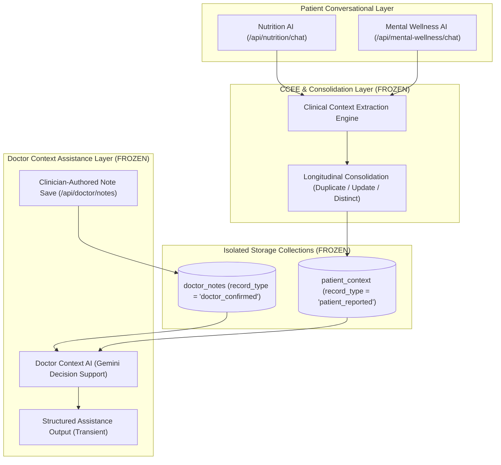

# PCIF Prototype Hardening & Freeze Readiness Specification (`Day 17`)

This document details the final hardening, edge-case verification, privacy audit, configuration validation, and prototype freeze readiness of the **Patient Context Intelligence Framework (PCIF)** before research evaluation.

---

## 1. Architecture Freeze Statement

The PCIF multi-channel context architecture is officially **FROZEN** for comparative evaluation:

---

## 2. Patient Conversational Data Minimization & Closure Policy

To prevent conversational assistants from conducting open-ended clinical intakes and accumulating unnecessary context, Day 17 establishes an explicit **Data-Minimization and Natural Closure Policy**:

1. **Answer First**: The assistant answers the patient's immediate question or concern directly before asking anything else.
2. **Targeted Follow-Ups**: Asks follow-up questions *only* when the missing detail is genuinely necessary to provide safe, personalized guidance (maximum 1 question at a time).
3. **Natural Conclusion**: Once sufficient context exists to address the concern, concludes naturally (e.g., *"If you would like to explore any of these ideas further, let me know."*) and allows the user to initiate further discussion.
4. **Safety Exception**: In crisis situations (self-harm, immediate danger, acute physical red flags), necessary emergency guidance and escalation questions continue unconditionally.

---

## 3. Edge-Case Verification & Defect Hardening

| Hardening Area | Verified Behavior | Defect / Action Taken | Status |
| :--- | :--- | :--- | :--- |
| **Malformed Requests** | Missing/null/whitespace `patient_id`, `consultation`, `message`, `note` or invalid JSON types return controlled `422 Unprocessable Content`. | Verified across all API routes. | **PASSED** |
| **Extreme Input Lengths** | Payloads up to 14 KB (conversations, notes, consultations) processed safely without memory exhaustion, stack traces, or DB corruption. | Zero crashes or unbounded logs. | **PASSED** |
| **Whitespace Normalization** | Untrimmed patient identifiers (e.g. `"   patient_001   "`) are cleaned and stored consistently. | Consistent normalization verified. | **PASSED** |
| **Unicode & Multilingual Safety** | Tamil scripts (`தமிழ்`), accented Latin characters (`régimen dietético`), and emojis (`😴`) are preserved accurately across storage and APIs. | Full encoding fidelity preserved. | **PASSED** |
| **Stale Response Protection** | Switching `patient_id` while a Doctor Context or Note request is in flight invalidates the older request ID, discarding stale responses. | Added `activeRequestIdRef` and `activePatientIdRef` guards in `DoctorDashboard.jsx`. | **PASSED** |
| **Duplicate Submissions** | Doctor Context AI calls cause zero writes on repeated clicks. Clinician note saves are append-only. | Verified in `test_day17_hardening.py`. | **PASSED** |
| **HTTP Method Safety** | Unsupported HTTP methods (e.g. `GET` on `POST` endpoints) return `405 Method Not Allowed` without state mutation. | Standard FastAPI 405 behavior verified. | **PASSED** |
| **Interleaved Patient Isolation** | Rapid alternating operations across Patient A and Patient B maintain strict stateless isolation. | Zero cross-patient leakage. | **PASSED** |

---

## 4. Privacy, Security & Configuration Audit

1. **Secret & Git Hygiene**:
   - `.env` and `.env.local` are strictly gitignored.
   - `.env.example` contains only non-sensitive placeholder variables.
   - Automated git scan (`git grep -i "AIza"`) confirmed **zero committed API keys**.
2. **Logging Sanitization**:
   - Audited backend logging statements.
   - Sanitized CCEE JSON parsing error logs to prevent dumping raw model text into application logs.
3. **Database & Index Audit**:
   - Compound indexes verified for `patient_context` (`(patient_id, captured_at)`, `(patient_id, is_current, captured_at)`, `(patient_id, source, category)`) and `doctor_notes` (`(patient_id, created_at)`).
   - Unreachable MongoDB raises controlled `HTTP 500` without leaking database connection URI credentials.
4. **Temporal Semantics**:
   - `captured_at` represents context persistence timestamp.
   - `created_at` represents clinician note persistence timestamp.
   - Timestamps are never treated as symptom onset or clinical encounter dates.

---

## 5. Test Suite & Build Results

- **Day 17 Hardening Suite** (`tests/test_day17_hardening.py`): **17 / 17 PASSED**
- **Full Backend Regression Suite** (`unittest discover`): **114 / 114 PASSED** (`Ran 114 tests in 90.157s, OK`)
- **Frontend Production Build** (`npm run build`): **SUCCESS** (`✓ 1477 modules transformed in 2.38s`, 0 errors)
- **Live MongoDB Ping**: **True** (Database connected and operational)

---

## 6. Known Prototype Limitations

The following limitations are inherent to the prototype research boundary and will remain active during evaluation:
1. **No Authentication / RBAC**: Prototype operates without user login or role-based access control.
2. **Session Identifiers**: Patient ID is an opaque session identifier stored in `sessionStorage`.
3. **No EHR / FHIR Integration**: Prototype uses standalone MongoDB collections.
4. **No Clinician Authentication**: System does not verify clinician credentials or licence numbers.
5. **Deterministic Context Limits**: `MAX_HISTORY_LIMIT = 20`, `MAX_CLINICIAN_NOTES = 10`.
6. **No Clinical Validation**: PCIF is an assistive prototype for research study; it is not approved for unsupervised clinical use.

---

## 7. Freeze-Readiness Conclusion

### **TECHNICAL FREEZE READINESS: YES**

The PCIF prototype is stable, hardened, fully verified across 114 backend tests, and ready for comparative research evaluation.
